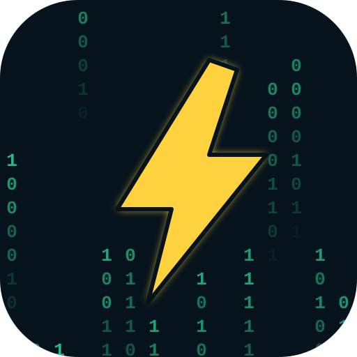

# CEB Mauritius — Home Assistant integration

Unofficial Home Assistant integration for **CEB (Central Electricity Board) Mauritius**, using the
MoKouran mobile app backend. Brings your electricity account into Home Assistant: balance, meter
reading, consumption (hourly / daily / monthly) and an estimated bill on your tariff.

> Not affiliated with or endorsed by CEB. Reverse-engineered from the MoKouran app for personal use.
> No warranty. Use at your own risk.

## Features

Sensors (`sensor.ceb_<account>_*`):

| Sensor | What |
|---|---|
| `amount_due` | Account balance (Rs) |
| `bill_due_date` | Bill due date |
| `last_meter_reading` | Latest meter reading |
| `last_reading_date` | Date of that reading |
| `last_consumption` | kWh of the last completed billing period (12-month `history` attribute) |
| `daily_consumption` | Latest day kWh (30-day `history` attribute) |
| `latest_day_total` | Latest complete day, 24-hour `profile` attribute |
| `month_consumption` | kWh in the current open billing period (from the last meter read) |
| `estimated_month_cost` | Estimated Rs for the current period (inclining-block tariff + meter rental) |
| `year_consumption` | Sum of the last 12 months (kWh) |
| `estimated_year_cost` | Estimated Rs over 12 months (monthly `history` attribute) |
| `tariff` | Tariff code (e.g. 110A) |

Polls every 6 hours (CEB data lags ~1–2 days); retries in 15 min after a failure.

## Planned outages

`sensor.ceb_<account>_planned_outages` = count of CEB planned power cuts, scraped from
<https://ceb.mu/customer-corner/power-outage-information>. The full list is in the `outages`
attribute: `[{district, date, start, end, locality, streets}]`. The sensor counts only **upcoming** outages (today onward, soonest first) and exposes
`next_date`, `next_start`, `next_end`, `next_locality`, `next_streets`.

`binary_sensor.ceb_<account>_outage_in_my_area` turns **on** when a future outage matches your filter —
use it for notifications. Same `next_*` attributes.

Use the integration's **Configure** dialog to pick a **district** and an optional **locality / street
keyword**. With a locality keyword, only outages whose locality/streets contain it match (e.g. `PEREYBERE`),
so you are alerted only for your area. Refreshed every 6 h, independent of your account login.
(It is an HTML scrape — may break if CEB changes the page.)

## Install (HACS)

1. HACS → ⋮ → **Custom repositories** → add this repo, category **Integration**.
2. Install **CEB Mauritius**, then restart Home Assistant.
3. **Settings → Devices & Services → Add Integration → CEB Mauritius**.

## Setup

Choose **Register with my MoKouran email**:

1. Enter the email you registered **in the MoKouran app** (this may differ from your CEB bill email),
   choose a 4-digit PIN for Home Assistant, and your contract number (on your bill).
2. CEB emails a one-time code; enter it.

Home Assistant registers itself as its own MoKouran device (its own device ID + that PIN), separate
from your phone. The **Advanced** option accepts an existing device ID + PIN directly.

Common errors:
- *No MoKouran app user for that email* — use the email registered in the MoKouran app.
- *The code was rejected* — re-request and retry; codes expire.

## Tariff & cost estimate

Costs are **estimates** from the gazetted CEB residential tariffs (110A / 110 / 120 / 140; 150C
Time-of-Use is not costed), picked automatically from your account's tariff code, plus the fixed
monthly meter rental. One-time charges (connection fee, security deposit) are excluded. A CEB levy or
fuel-price adjustment, if any on your bill, is not included — see `custom_components/ceb/tariff.py`
to calibrate from a real bill. VAT is not applied (residential electricity is VAT-exempt in Mauritius).

## API notes

The MoKouran backend is a LoopBack 3 REST API at `https://mobile.ceb.mu/api/`. Full reverse-engineering
notes: [`custom_components/ceb/CEB_API.md`](custom_components/ceb/CEB_API.md).

## License

MIT — see [LICENSE](LICENSE).

## Known limitation — one active device per account

CEB's MoKouran backend allows only **one active device per account**. This integration registers
Home Assistant as a device via `activateAccountOnAnotherDevice`, which **replaces** whatever device
was active before (it does not add one).

Consequences:
- Registering Home Assistant **logs you out of the MoKouran phone app**.
- If you then open/use the phone app, it re-registers and **kicks Home Assistant**. HA's next poll
  fails with `USER_NOT_EXIST` -> `ConfigEntryAuthFailed` -> reauth. Re-entering the PIN alone will **not**
  recover it, because the *device* binding is gone, not just the PIN — you have to re-add the integration.

This is a CEB backend constraint, not something the integration can work around.

**Recommendation:** use a **dedicated MoKouran account** for Home Assistant (register a separate CEB app
account with its own email), or accept that HA and the phone app cannot be logged in at the same time.

